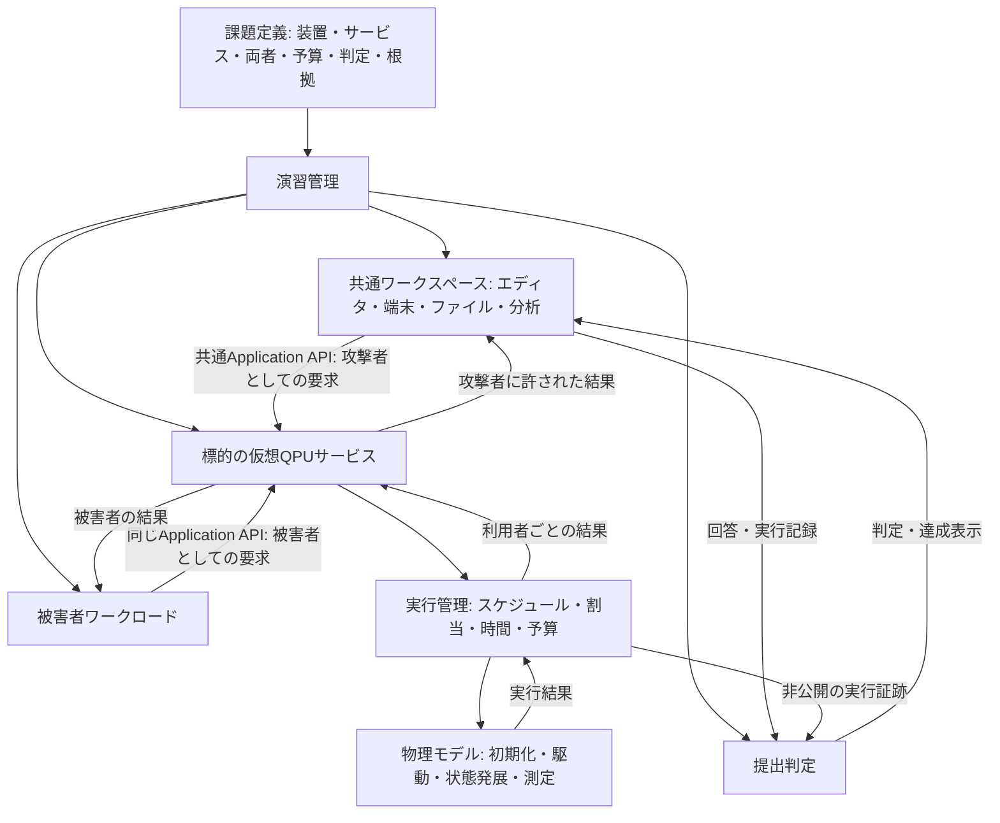

# 製品構造とモデル境界

最終同期: 2026-10-08。以下は設計の骨格であり、API・スキーマの実装仕様ではない。

合意済みなのは明示した体験方針と[共通操作・観測・校正契約](common-command-observation-contract.md)であり、下記の責務図はその具体化案である。
正式schemaと配備単位は未決定。製品全体の成立条件は、攻撃者から被害者へ届く設定で宣言された共有資源・経路があること。共有QPUは必須前提ではなく、一つのservice profileとする。NISQは製品全体の不変条件にせず、実行方式をdevice／service profileとして選択する。現行Reset課題は同一QPUのNISQ物理層だけに対応する。
この「届く」は一方向の物理信号を意味しない。攻撃者の操作入口、共有資源、被害者の保護資産へ作用する機構、攻撃者が得る観測を分ける。Reset漏洩では攻撃者のジョブが共有量子ビットに到達し、被害者由来の残留状態が攻撃者自身の測定へ返る。
現行内部v0では`relation.attack_path`にこの五要素を宣言し、service profileが機構を支持することと、Reset runtimeが経路を実行できることを開始前に検査する。汎用`ScenarioCompiler`はmanifest生成器であり、全機構の成立を判定する検査器ではない。自由modeの対照条件で共有配置を外す場合、宣言された候補経路は残っても実際の効果は遮断される。これは攻撃成功例ではなく負の対照である。
Reset内部v0ではさらに`relation.resource_binding`へ被害者・攻撃者それぞれの`qpu_id`と`physical_qubit_id`を置き、service側の`resource_inventory`に存在することを要求する。同一量子ビット配置は両IDの一致、隔離対照は同一QPU上の異なる量子ビットIDを要求する。ResetのRuntimePlanと実行状態の初期QPU・量子ビットIDを開始前に照合し、隔離対照の割当eventでは局所状態枠の物理量子ビットIDを切り替える。これは一時点に一量子ビットだけを保持する閉じた近似であり、複数QPUまたは二量子ビット同時計算の実装ではない。
直近の議論・状態寿命の懸念・8責務候補は [レイヤー別整理](layered-discussion.md) を参照。
サービスごとの機能・権限・成立条件は [サービス差とアクセス条件](service-and-access-model.md) を参照。
一般モデルをFIFOと同一視せず、方針・制約・観測の特殊化でサービス差を表す方針を採用した（D55）。[特殊化の定義・確認義務・仕様片への対応案](service-specialization-contract.md)を参照。個別providerの実装や形式的証明は未完了であり、下記の責務図の全採用を意味しない。
共通世界、局所実行領域、時間と処理落ち、観測経路の実装契約は [実行境界・時間・矛盾解消方針](runtime-boundaries-and-resolutions.md) を参照。

## 共通契約と課題設定の依存方向（2026-10-04）

依存方向は **共通契約 → サービス／物理profile・被害者workload → 課題preset** とする。課題例は共通構造の反例検査に使うが、最初の課題を選ぶまで共通時間・状態所有・認可・操作契約を定められない構造にしない。

D57で[共通基盤v1の五暫定契約](common-foundation-v1-contract-proposal.md)を採用した。D58では全体の百量子ビット級metadata、一回路の編集上限8、保持する局所物理領域幅を分離する。今回`QpuTopology`と`RetainedRegionBinding`で分岐・閉路・非連番ID、制御伝達／Readout共有を保持し、局所state／session manifestへ照合接続した。ゲートrouting・動的領域選択・active physicsの接続は未完了で、metadataの保持をそれらの実行対応と扱わない。

- 共通契約: 三種類の時間、開始・進行・event確定・公開の規則、状態所有、認可、操作／Program境界、設定凍結、ホスト保護。課題IDやgraderの合否で切り替えない。
- サービス／物理profile: 通信・処理・物理操作の宣言duration、queue・割当・初期化／Reset・観測公開条件、対応modelと係数。共通契約の範囲内で成立前に選ぶ。各shotの準備とtenant交代Resetは別条件であり、攻撃者だけを例外にしない。
- 被害者workload: いつ・何に・どの共通操作を行うか、結果依存、反復・終了上限。共通時計と操作catalogを消費し、時計やserviceを所有しない。`WorkloadPlan`のtyped v1／有限JSON入力・純粋進行器と、認証済み共通sessionへの宣言到達runnerを実装した。現在の操作は共通`program.submit`で、両主体がProgram参照・prepare／inherit・自己counts分岐・有限反復を使う。凍結manifestからのみ組み立て、時計開始前に全予定を予約する。有限sourceの物理実行・公開時刻・frontier接続は下記coordinatorへ追加したが、live HTTPとの到達対応は残る。[受付接続の境界](parallel/declared-workload-handoff.md)を参照。
- 課題preset／判定: 上記の対応済み構成を束ね、固定・秘匿・観測量・提出・評価を設定する。32 shots/case、training、二値秘密、相互情報量、hidden件数、seed選別はReset課題の条件であり、他課題へ強制しない。

共通`ScenarioPolicy`／manifestの`observation_budget`は任意のpaired training／victim query予算とし、不要な構成は`None`（serialized `null`）を明示する。既存Reset runtimeは明示予算を必須とし、欠落を無制限へ変換しない。予算を使わない課題でもserviceのshots／命令上限・sessionのhost資源上限・設定凍結・認可は解除されない。別種の予算channelのschemaは未定義であり、この変更が全課題の予算管理を実装した意味ではない。

主体の`operation_grants=[]`は明示的な権限ゼロとして許し、全操作を拒否する。両主体が必ずジョブ送信することを共通前提にしない。grantの欠落・不正値・重複、課題の固定／根拠不足は引き続き拒否する。共通設定UIは三主体だけでなく`relation`／`experiment`の公開descriptorも同じ検査・成立後固定で扱い、課題の秘密や非公開設定を取得する経路にしない。

共通Program・terminal・HTTP候補は課題専用orchestratorを必須にしていない。一方、現FIFO runtimeのReset用legacy operation／resource binding、同期query反復は内部adapterに残る。現adapterの対応範囲を全製品の不変条件としない。旧課題の共通Program移行は未完了で、未合意の初期化・割当・時間条件を補って接続しない。

有限宣言列の物理adapterは、共通認証sessionから物理計算を正本外で行い、待機／STARTと物理batch／FINISHを共通state・job・frontierへ原子的に確定する。後続`ClosedWorkloadWorld`で、凍結submit-only sourceからclock target同期、FIFO window／公開時刻生成、予約とresult下界による安全seal、自己結果反復を接続した。全主体／両modeは同じownerを使う。durationは成立前service設定と既存Programから生成し、最初の課題の数値を採用しない。idle係数、service根拠の採用、live HTTP／control到着・実運用loop・UI・復旧は残る。[有限sourceの保証範囲](parallel/closed-workload-world-handoff.md)を参照。

Web公開も配備対象とする。ここでのWebはCloudflare等の実際の公開基盤であり、模擬世界内のWebではない。D57でserver側の状態・判定正本、登録不要のブラウザ所有session、実利用者ごとの模擬環境隔離を採用した。公開基盤へ置くことと、模擬世界内のQPU／攻撃経路を共有することは別で、実通信・ホスト計算時間を模擬サービスの共有条件へ読み替えない。配備先、実認証の具体形式、資源隔離の実装は未確定・未完了。

live受付は`LiveIngress`、trusted位置での照会投影はexecutor／service、実所有scopeはsession／trusted owner resolverへ分けた。D59の凍結設定・時刻付き取消を、後続`LiveWorkloadWorld`でfinite actor source・live共通操作・FIFO再計画・START／FINISH・releaseへ時刻順に接続した。製品時計はD72により単調host clock（1x）で、`explicit_wait`は内部試験経路に限定。catch-up計算中だけ時計を止める選択を環境成立前に固定できる。製品WebSocketはclock更新・解放済みreplyをpushし、製品UIにwait／再生操作はない。数値計算遅延とQPU物理・宣言service時間を分ける。HTTP polling候補はrequest_id＋pollingの暫定候補として機能追加を止めている。desktop／development向けの経路はmount済み。公開運用、永続化・複数process復旧は未完了。[構造と対応範囲](parallel/live-ingress-boundaries-handoff.md#後続実装-共通live実行器)を参照。課題非依存で、同じPC／同じサイトownerを模擬共有QPUの根拠にしない。

## 利用者が操作する二つの階層（合意済み）

```text
上位: 攻撃シミュレーター設定
  CTF型プリセットの選択 / 実機側・被害者側の条件設定
  プリセットは攻撃者・被害者・実機側の設定を保持する
                         ↓ 環境を構成
課題内: 攻撃側画面のみを操作
  コード・ターミナル・ツール → 標的へ要求 → 自分の結果を分析・提出
                         │
背景: 被害者ワークロード / 仮想QPUサービス / 物理モデル
  設定に従い実行。上位の環境設定を課題画面から無制限に編集しない
```

攻撃側の画面を唯一の操作入口とする。被害者・実機の設定UIは上位に置く。
課題内で標的サービスへ送る要求は攻撃者環境から発する。
下の責務図に被害者・演習管理があることは、それらを利用者が課題中に操作できるという意味ではない。
実機側は本製品内で模擬する装置環境を指し、現物の実機への接続を決定したものではない。

環境管理者は上位のメタ層に置き、参加者の資格情報発行は下位のQPUサービスへ置く。環境管理者の設定は自由／課題の両modeで開始前だけ変更可能とし、復旧再開で編集可能に戻さない（D52）。詳細と未確定の認証方式は[資格情報境界](credential-delivery-boundary.md#環境管理者とサービス発行の境界2026-10-04合意)を参照。

サービス方針と装置の物理特性は意味上区別する。画面配置、開始前の攻撃者設定の手動編集範囲、
上位設定へ戻る際の表示・棄却操作、設定変更後に新規開始する環境の提出資格は未決定。成立済み環境の仮定を直接編集する方式は採用しない。
課題終了後の内部状態の解説は候補であり、課題中の操作権限とは分けて設計する。

## 共通の体験フロー（ユーザー案を基にした整理）

設定→攻撃側へ移動→操作→実行・観測→課題別判定という骨格はユーザー提示に基づく。
以下の観測範囲・結果分離・反復を含む詳細は具体化案であり、API仕様の確定ではない。

1. **環境構成**: 手動設定またはプリセット適用。被害者・攻撃者・装置に加え、サービス条件を明示する。
2. **開始**: 攻撃側画面へ降りる。利用者はここからだけ攻撃を行う。
3. **調査・準備**: 許可された装置情報、キュー情報、課題で与えられた事前資料等を調べる。
4. **操作**: 利用可能な装置を選び、権限に応じた要求を送る。ジョブ作成はその一種。
5. **実行**: ジョブ経路では受付・検査・割当・初期化・物理実行・測定を行う。他の操作は対応する経路へ渡す。
6. **観測の返却**: 各利用者へ許可された結果だけを返す。別経路の観測には別のアクセス条件が必要。
7. **分析・反復**: 取得可能な観測から推定・計画を更新し、必要なら調査・操作を繰り返す。
8. **提出・解説**: CTF型の場合は目的に応じて判定する。自由実験では分析・比較を継続できる。

攻撃は実行後に別途発火させるイベントではない。操作と環境の因果関係から効果が生じ、条件が足りなければ失敗する。
被害者から攻撃者へ結果を自動転送する経路を共通機能にしない。
干渉の成否を攻撃者が直接確認できなくても、判定器が非公開の証跡で評価する課題は候補となる。

上位設定で装置を作成・変更することと、攻撃者が利用可能な装置から送信先を選ぶことは別。
「誰が何を渡すか」という共通フローと、「時間・状態がどう進むか」という実行規則も別に定義する。

## 一つのワークスペースに課題を設定する（共有QPU型ジョブ経路の責務案）

以下の図は最初の共有QPU型シナリオの責務案であり、複数QPUやサービス層の経路を一つの物理状態へ統合する図ではない。別の経路を採用する場合も、シナリオに共有対象、作用機構、権限、時間・配置条件、観測先を宣言し、実装が対応することを開始前に検査する。経路の存在だけで攻撃成功を保証しない。



課題を開くと同じワークスペースに接続先、初期ファイル、問題文、ヒント、提出欄を設定する。
課題ごとに専用の別物理エンジンを作らない。環境内部は共通基盤と設定の組合せで表す。
図の各箱は責務を示す。D57によりjob・QPU状態・予算・時刻・private判定の正本はserver側、編集・共通操作・許可された分析／表示はブラウザ側とする。server内部のprocess／container分割と、Sandbox後の攻撃者コード実行配置は未決定。
図はジョブを使う場合の中心経路であり、すべての攻撃をこの経路だけに限定しない。
攻撃者・被害者で公開operationを分けず、同じservice catalogに対する権限と結果投影を主体別に変える。
仮想計測器や利用部品の編集を採用する場合は、課題設定で追加の接続先・権限・被害者との関係を定義する。
部品編集は上位設定を直接変更することではなく、指定された攻撃経路からだけ行う。

## 責務と情報の境界

| 構成要素 | 保持・実行するもの | 直接与えないもの |
| --- | --- | --- |
| 攻撃者環境 | 自分のコード・回路・要求・取得結果・分析 | 被害者の秘密、非公開の割当履歴、全密度行列、判定の正解 |
| 標的サービス | 利用者別ジョブ、公開情報、権限、参加者の仮想資格情報発行・検証・失効、結果分離 | 攻撃者権限を超える操作、メタ管理者の権限 |
| 実行管理 | 割当、順序、仮想時刻、予算、物理モデルへの実行要求 | 被害者の時刻・配置を攻撃者へ無条件に公開する機能 |
| 物理モデル | 状態、Reset・駆動・測定に伴う変化 | モデル内部の全情報をそのままテナントへ返す機能 |
| 被害者ワークロード | 秘密入力、回路、実行予定、通常の結果利用 | 攻撃者へ無条件公開する内部情報 |
| 演習管理（メタ層） | 開始前の環境・管理者設定、環境成立・棄却、被害者起動、復旧管理、監査・解説 | 通常の攻撃者端末からの環境管理権限、成立後の管理者設定変更 |
| 判定 | 正解、対照、提出物評価、試行記録 | 過剰な判定応答による秘密の露出 |

ローカル解析に対する秘匿性は保証対象外。ただし通常経路の役割分離は設計する。
ホストPC保護、コード停止、計算上限はこの割り切りとは別問題である。

## 実サービス利用フローとの対応（ジョブ経路の一般形）

この節の「ジョブ」の語義と、操作要求・物理event・batch／sessionとの区別は[共有QPUサービス実行契約の第3.0節](service-runtime-contract-proposal-2026-09-23.md#30-ジョブの語義合意済み具体的なschemaは未決定)を参照する。

| フロー | 対応構造 | 本製品で必要な表現 |
| --- | --- | --- |
| 回路・コードの作成 | 手元PC、SDK | 攻撃者の端末、エディタ、回路ツール |
| 実行先への適合 | トランスパイラ、デバイス情報 | 対応命令・物理割当の入力と制約。処理場所は参照サービスに合わせる |
| ジョブ投入・待機 | 認証API、キュー | 要求、ジョブID、許可された状態情報 |
| 実行順序・配置 | スケジューラ、割当 | 時間共有・同時共有・専有のサービス方針 |
| 初期化・駆動 | 制御装置、配線、QPU | Reset、待機、パルスと結合、状態発展 |
| 測定・返却 | 共振器、測定鎖、分類、API | 物理測定と古典的Readout、利用者別返却 |

これは特定事業者の完全な再現ではない。クラウドのジョブ並列表示から、チップ上の同時駆動を推定しない。
共有方式は課題ごとに現実の根拠・研究上の仮定・教育的簡略化を分けて記録する。

## 装置・サービス・被害者・攻撃者・課題の設定

共有方式は上位の「被害者・利用環境設定」から扱えるようにする。ただし、被害者側が指定するのは希望する利用条件であり、実際の共有方式・割当・保証はQPU service側が所有する。
内部データは次の意味上の責務へ分ける（正式フィールド名は未定）。

- 装置: `execution_regime`、結合・ノイズ・Reset・Readout等の物理特性。`nisq_physical`と将来の`fault_tolerant_logical`を同一挙動として扱わない。
- サービス: 公開命令、パルス対応、共有方式、実際の割当、Reset適用方針、公開情報。
- 被害者: 回路、秘密入力、ショット数、利用先、専有や予約の要求、結果利用。
- 攻撃者: 役割、アカウント、接続経路、許可操作、観測範囲、事前知識。
- 課題: これらの対応、目的、予算、問題文、成功判定、根拠と追加仮定。

主体が所有する設定は、`AttackerConfig`・`VictimConfig`・`QpuServiceConfig`の三設定へ置く。
ただし通信、配置、時間関係等を一主体へ押し込まず、`RelationConfig`として分ける。開始条件、training、対照等は`ExperimentConfig`、固定・秘匿・提出管理は`ScenarioPolicy`が担う。DeviceProfileは初期案ではQPU Serviceから版付き参照を持つ。
これは責務上の境界であり、画面数、内部モジュール数、正式field・永続化schemaは[仮定取扱契約](assumption-handling-contract.md)の提案をレビューして決める。
詳細な能力候補と観測区分は [サービス差とアクセス条件](service-and-access-model.md) を参照。

被害者が要求した専有と、サービスが実際に保証する専有は別の情報。
Reset効率や結合係数を通常テナントが編集できる設定にはしない。

## 実装言語とruntime境界（採用基準は合意済み、範囲は未決定）

攻撃シミュレーターのイベント処理・状態管理はRust化の候補とする。目的は速度だけではなく、唯一の状態所有者を明確にし、並行更新とメモリ安全性を扱いやすくすることにある。Rustを採用する条件は、PyO3変換の概ねO(n)のコストについて定数倍を含めて見積もり、その総費用より対象ボトルネックの解消効果が十分大きいこと。複雑度の次数だけでは採否を決めず、end-to-endで比較する。Rust化の対象と時期は未決定である。

責務の候補は次のとおり。

- Rust runtime候補: job／eventの順序、queue policy、状態revisionの検査とcommit、runtime資源上限、決定的なevent記録。これらのうち実測で採用条件を満たす機能をRustへ置く。
- Python候補: FastAPI、scenario authoring/compiler、認可・課題policy、公開結果への投影、永続化adapter。これらはデータ契約が固まるまで現行のPython側に置く。
- 呼出し単位: Python/Rust間はjob、shot batchまたは実行window単位で処理をまとめる。軽い個別eventごとのFFI往復を避ける。
- 型検査とbuffer: 公開入力・schema・domain型の検査をPythonで済ませ、Rustには型付きデータを渡す。配列は共有bufferを使ってゼロコピーで渡すことを基本とし、連続性・dtype・所有期間など成立条件を契約化する。現行の`core.gates.Matrix`はtuple-of-tuplesなので、そのまま共有bufferにはならない。状態データをRust境界へ渡す前に、連続bufferを正本とする表現へ変更するかを決める。Rust側にもbuffer長やメモリ安全性を守るための最小限の検査を残す。
- 物理計算: Rust／Python等のbackendを選択可能にする。backend境界はjobまたは実行window等のまとまりとし、各eventの細かな値を毎回PythonとRust間で往復させない。
- 永続化: Rust採用とは分けて設計する。保存媒体、transaction、schema migration、再起動復元の要件は別途決める。

Rustを採用する場合、PythonとRustに二つの正本runtimeを並立させない。Rust側が状態・eventの唯一のauthorityとなり、Pythonとの間は型と版を持つcommand／result境界にする。Pythonでdomain型を検査してからバッチで渡し、数値配列は共有bufferでゼロコピーにする。非連続配列や異なるdtype等でゼロコピーできない場合は、暗黙の反復コピーを避け、境界で一度だけ正規化するか、対応外として拒否する。Rustのメモリ安全性は、Python等から未信頼コードを実行するsandboxの代替ではない。

実装判断の前に、job／event状態遷移と失敗時のcommit規則、履歴・queueの上限、共有bufferの型・layout・所有期間を契約化する。次にPython基準実装とRust境界を含むend-to-end計測で、event管理の処理時間、FFI呼出し・データ変換の比率、最大保持量、決定的再現性を比較する。FFI往復と大きな状態データの変換・コピーを含めて採用条件を評価し、条件を満たす範囲だけRust化する。Rust化だけで認可・秘匿・状態遷移の正しさや、利用者コードの隔離が保証されるわけではない。

## 攻撃目的と成立機構

主要な目的は O1: 結果への干渉・改ざん、O2: アルゴリズム・回路・命令推定、O3: 埋め込まれた秘密の推定。
以下は目的そのものではなく、目的を達成するための物理・運用上の機構候補である。

| 候補 | 必要な物理・運用条件 | 観測と判定の候補 |
| --- | --- | --- |
| 時間共有・不完全Reset | 同じ資源の再利用、待機・初期化後も残る被害者依存 | 攻撃者自身の測定から秘密を推定。単なる一定の測定床とは区別 |
| 同時共有・駆動クロストーク/ZZ | 実際の時間重複、影響を生む信号・結合経路、必要な操作能力。近接が必須かはモデル次第 | 被害者の状態占有確率・位相差、または攻撃者観測からの推定 |
| 共有測定・相関Readout | 特定の測定経路と時間関係、他者状態に依存する分類確率 | 独立Readoutの対照に対する条件付き観測の差 |

これらすべてが既存商用サービスで正規ユーザーに成立する、と主張しない。
初期課題は、MiらCCS 2022を根拠にした単一QPU・FIFO上の同一量子ビット順次再利用とする。保護資産は被害者の非公開出力bit、攻撃目的はReset越しの情報推定である。Reset課題専用v0の評価case数・合格閾値・決定論的受入閾値は校正後に採用済み。有限sampleの統計許容差と実行上限は未決定である。
文献調査では制御装置の電力観測と、被害者が使うパルス部品の変更も候補として整理した。
共有QPUジョブ経路と異なるアクセスを要するため、採用可否は別途決める。

## 時間・判定・編集の設計候補

- 利用者・攻撃者環境の経過時間、シナリオ／仮想装置時間、ホスト処理時間を分ける。
- 利用者側の要求到着時刻はシナリオへ影響し得るが、物理計算に要したホスト処理時間を仮想QPUの実行時間へ加算しない。
- D57の初期1倍は履歴上の合意。現在のlive進行方式はD60に従い、成立前manifestで`explicit_wait`／`host_clock`を選び固定する。未指定は拒否する。通信区間／宣言値、同時イベントのサービス妥当性は引き続きprofileごとの検討事項。
- 演習予算（ジョブ・ショット等）と実行上限（CPU・メモリ・タイムアウト等）を分ける。
- 課題条件の変更は成立前に行い、成立済み環境を変更する場合は棄却して新規開始する。正式提出との分離は実行証跡に基づく。基盤異常からの復旧再開は設定を変えない別の操作とする（D51）。
- 秘密の復元、未知ケースの推定、対照に対する干渉は別の判定を用いる候補。
- 学習者の成功表示と、物理的に主張できる影響の範囲を両方示す。

## 議論で参照した資料

以下は2026-09-13までの会話で参照した資料。今回の文書同期で外部資料の再調査はしていない。
実装契約を決める際には対象サービス・版・該当箇所を再確認する。
2026-09-19までの追加調査と適用限界は [サービス差とアクセス条件](service-and-access-model.md) に集約した。

- [IBM: 実行モード選択](https://quantum.cloud.ibm.com/docs/en/guides/choose-execution-mode): 古典処理の並列化とQPU実行、排他セッションの区別。
- [IBM: トランスパイル](https://quantum.cloud.ibm.com/docs/en/guides/transpile): 実行先の命令・接続関係への適合。
- [Amazon Braket: タスク監視](https://docs.aws.amazon.com/braket/latest/developerguide/braket-monitor-console.html): 公開される自分のタスク情報の例。
- [NDSS 2025: Crosstalk-induced Side Channel Threats](https://www.ndss-symposium.org/wp-content/uploads/2025-2185-paper.pdf): 同時共有を前提とする研究例。一般クラウドでの配置保証とは区別。
- [CTFd: 課題作成](https://docs.ctfd.io/tutorials/challenges/creating-challenges/)、[flag仕様](https://docs.ctfd.io/docs/flags/overview/): 課題定義・提出機構の参考。
